<p align="center">
  
</p>

<p align="center">
  <a href="https://pierreessirard.github.io/carnet-voyage/"><b>Voir le site</b></a>
  ·
  <a href="#les-road-trips">Les road trips</a>
  ·
  <a href="#le-faire-tourner-chez-soi">Le lancer en local</a>
</p>

<p align="center">
  
  
  
</p>

---

J'ai passé 4 mois à Montréal. Plutôt qu'un album photo de plus, j'ai voulu un carnet qu'on **parcourt en faisant défiler la page** : la carte suit le récit, vole d'une étape à l'autre, et dessine les trajets au fur et à mesure.

Ça commence par le vol Paris → Montréal, puis on se balade dans Montréal en 3D (à pied, en vélo, en métro, depuis chez moi rue Prince-Arthur), et ensuite on part sur les road trips.

## Les road trips

<p align="center">
  
</p>

| # | Où | Étapes |
|:-:|----|--------|
| 1 | **Québec, Jacques-Cartier & Tadoussac** | Québec · Parc de la Jacques-Cartier · Tadoussac |
| 2 | **Toronto, Niagara, Sandbanks & Ottawa** | Toronto · Chutes du Niagara · Sandbanks · Ottawa |
| 3 | **New York, Long Island, Lake George & Whiteface** | New York · Long Island · Lake George · Whiteface |
| 4 | **La Mauricie** | Parc national de la Mauricie · La Tuque (hydravion) |
| 5 | **Mont Washington, Maine & Boston** | Mont Washington · Portland · Kennebunkport · Ogunquit · Portsmouth · Boston |

Tous partent de Montréal et y reviennent.

## Ce qu'il y a dedans

- **Une intro** : la Terre en points, et un avion qui traverse l'Atlantique au rythme du défilement.
- **Montréal en 3D**, avec les bâtiments en relief. Chaque trajet est animé, et un petit 🚶 / 🚲 / 🚇 avance sur le parcours pendant que la caméra le suit.
- **Les road trips** : la route se dessine sur la carte, puis la caméra se pose sur chaque étape.
- **Un compteur de kilomètres** qui grimpe au fil du voyage.
- **Les photos** de chaque étape, en grand au clic.
- **Un espace privé** (la petite roue ⚙️ en haut à droite) protégé par un code, pour ajouter mes photos et vidéos depuis mon téléphone, sans toucher au code.

> [!TIP]
> Sur téléphone, la carte est en bas de l'écran. Glisse-la vers la gauche ou la droite pour la ranger sur le côté, et touche la languette pour la faire revenir.

## Le faire tourner chez soi

Le site utilise des modules JavaScript, donc **il ne marche pas en double-cliquant sur `index.html`**. Il faut un petit serveur local :

```bash
python -m http.server 8000
```

Puis ouvre <http://localhost:8000>. Avec VS Code, l'extension *Live Server* fait la même chose.

## Modifier le contenu

Presque tout se passe dans [`js/data.js`](js/data.js) : les textes, les lieux, les coordonnées et les trajets.

<details>
<summary><b>Ajouter un trajet dans Montréal</b></summary>

<br>

Dans `MONTREAL.parcours` :

```js
{
  titre: "Prince-Arthur → Mont-Royal",
  de: { nom: "Chez moi", lon: -73.5738, lat: 45.5133 },
  par: [                                   // facultatif : arrêts en chemin, dans l'ordre
    { nom: "Belvédère Kondiaronk", lon: -73.5871, lat: 45.5040 },
  ],
  a:  { nom: "Lac aux Castors", lon: -73.5960, lat: 45.4980 },
  transport: "pied",                       // pied, velo, metro, bus, voiture, train, bateau
  texte: "Ce que j'ai fait…",
  photos: [],
  video: "",
},
```

À pied, à vélo, en bus ou en voiture, le trajet suit les vraies rues. En métro, en train ou en bateau, c'est une ligne droite.

</details>

<details>
<summary><b>Ajouter une étape à un road trip</b></summary>

<br>

Dans le tableau `etapes` du road trip :

```js
{ nom: "Tadoussac", lon: -69.7166, lat: 48.1440, zoom: 12.5, pitch: 60, bearing: -40,
  texte: "…", photos: [], video: "" },
```

`zoom`, `pitch` (inclinaison) et `bearing` (orientation) sont facultatifs : ils règlent la caméra sur cette étape.

</details>

<details>
<summary><b>Trouver les coordonnées d'un lieu</b></summary>

<br>

Sur Google Maps, fais un clic droit sur l'endroit : la première ligne du menu donne `lat, lon`.

> [!WARNING]
> Google donne la **latitude d'abord**, alors que `data.js` attend `lon` puis `lat`. Ne les inverse pas, sinon le point atterrit en Antarctique.

</details>

<details>
<summary><b>Ajouter des photos</b></summary>

<br>

Le plus simple, c'est l'espace privé : <kbd>⚙️</kbd> → code → choisir la section → envoyer. Les photos s'affichent directement sur le site.

On peut aussi les mettre dans `assets/photos/` et les lister dans `data.js` :

```js
photos: ["assets/photos/tadoussac-1.webp", "assets/photos/tadoussac-2.webp"],
```

> [!NOTE]
> Garde des noms de fichiers sans espaces ni accents (`lake-george-1.webp`). Vise environ 1600 px de large, et ne mets pas sur GitHub de fichier de plus de 100 Mo : compresse les vidéos ou mets-les sur YouTube.

</details>

## Comment c'est rangé

```text
carnet-voyages/
├── index.html
├── css/
│   ├── style.css         le design du site
│   └── prive.css         l'espace privé
├── js/
│   ├── data.js           le contenu : lieux, textes, trajets
│   ├── main.js           relie le récit et la carte
│   ├── intro.js          le globe et le vol Paris → Montréal
│   ├── map.js            la carte 3D, la caméra, les trajets animés
│   ├── carte-fx.js       les effets visuels sur la carte
│   ├── objets.js         les scènes photo de chaque chapitre
│   ├── story.js          génère les blocs de texte
│   ├── scroll.js         repère la section à l'écran
│   ├── effets.js         apparitions, barre de progression, visionneuse
│   ├── odometre.js       le compteur de kilomètres
│   ├── routing.js        calcule les itinéraires sur les vraies routes
│   ├── itineraires.js    les routes déjà calculées (évite que le serveur bloque)
│   ├── geo.js            petits calculs de distance et de cap
│   ├── prive.js          l'espace privé (Firebase)
│   └── firebase-config.js
└── assets/
    ├── photos/  videos/
    ├── vendor/           d3 + fond de carte du globe
    └── readme/           les images animées de ce README
```

## Avec quoi c'est fait

Pas de framework ni de build : du HTML, du CSS et du JavaScript, servis tels quels par GitHub Pages.

| Pour | J'utilise |
|------|-----------|
| La carte et les bâtiments 3D | [MapLibre GL JS](https://maplibre.org/) |
| Le fond de carte (gratuit, sans clé) | [OpenFreeMap](https://openfreemap.org/) |
| Les itinéraires sur les vraies routes | [OSRM](https://routing.openstreetmap.de/) (OpenStreetMap) |
| Le globe de l'intro | [d3-geo](https://d3js.org/d3-geo) + [TopoJSON](https://github.com/topojson/topojson) |
| Les photos de l'espace privé | [Firebase](https://firebase.google.com/) |

---

<p align="center"><sub>Pierre Essirard · Montréal, 2026</sub></p>
